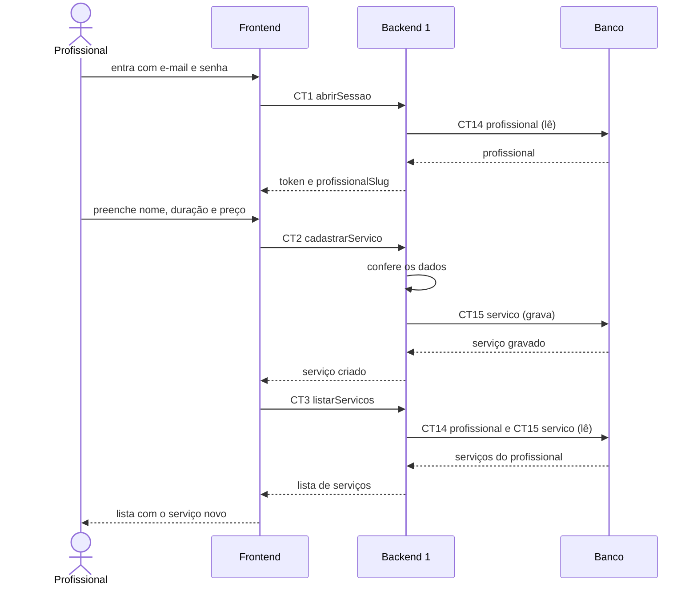

# Fluxo do E1: Cadastro de serviço

**Feito quando (da Entrega 1):** O profissional cadastra um serviço com nome, duração e preço, e ele aparece na lista de serviços oferecidos.

## Passos

1. O profissional abre o Frontend e entra com e-mail e senha.
2. O Frontend chama o Backend 1 com a operação abrirSessao (CT1). O Backend 1 lê o profissional na tabela profissional (CT14), confere a senha e devolve o token e o profissionalSlug.
3. O profissional abre "Meus serviços" e preenche nome, duração em minutos e preço de um serviço novo.
4. O Frontend chama o Backend 1 com a operação cadastrarServico (CT2), mandando o token.
5. O Backend 1 confere os dados e grava o serviço na tabela servico (CT15), ligado ao profissional do token.
6. O Backend 1 responde ao Frontend com o serviço criado.
7. O Frontend chama listarServicos (CT3) com o profissionalSlug. O Backend 1 lê as tabelas profissional (CT14) e servico (CT15) e devolve a lista.
8. A tela mostra a lista de serviços oferecidos, já com o serviço novo.

## Diagrama

**Contratos usados:** CT1 abrirSessao, CT2 cadastrarServico, CT3 listarServicos, CT14 profissional, CT15 servico.
