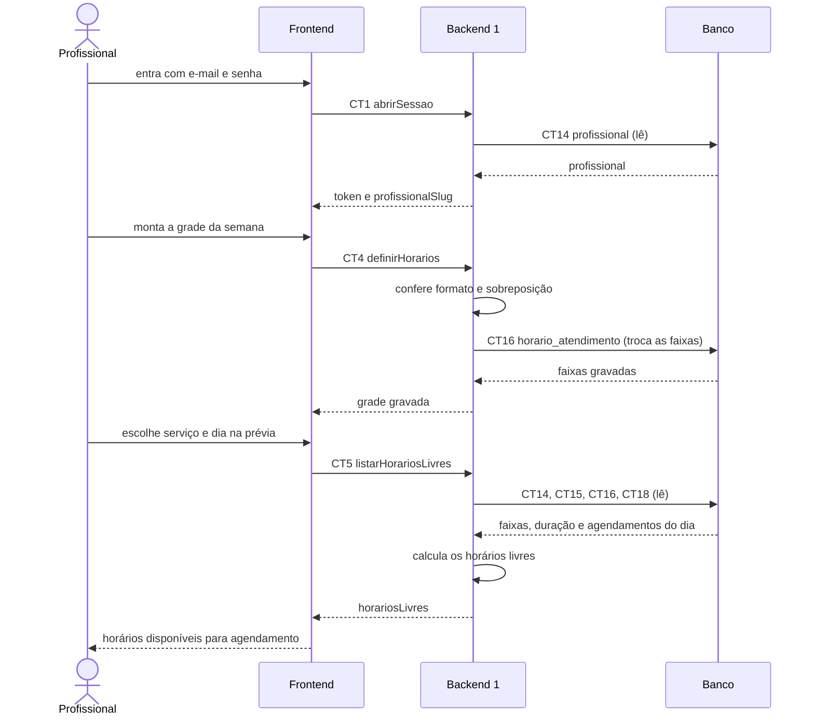

# Fluxo do E2: Configuração de horários de atendimento

**Feito quando (da Entrega 1):** O profissional define os dias e horários em que atende, e esses horários passam a aparecer como disponíveis para agendamento.

## Passos

1. O profissional entra com e-mail e senha. O Frontend chama abrirSessao (CT1) e o Backend 1 lê a tabela profissional (CT14).
2. O profissional abre "Meus horários" e monta a grade da semana: para cada dia em que atende, uma ou mais faixas (por exemplo, terça das 09:00 às 12:00 e das 14:00 às 18:00).
3. O Frontend chama o Backend 1 com a operação definirHorarios (CT4), mandando a grade inteira.
4. O Backend 1 confere o formato das horas e se nenhuma faixa se sobrepõe a outra do mesmo dia.
5. O Backend 1 troca as faixas antigas do profissional pelas novas na tabela horario_atendimento (CT16) e responde com a grade gravada.
6. Para conferir, o profissional escolhe um serviço e um dia na prévia "Como o cliente vê". O Frontend chama listarHorariosLivres (CT5).
7. O Backend 1 lê as tabelas profissional (CT14), servico (CT15), horario_atendimento (CT16) e agendamento (CT18) e calcula os horários livres: começos de 30 em 30 minutos dentro das faixas daquele dia da semana, em que o serviço inteiro cabe antes do fim da faixa e não se sobrepõe a nenhum agendamento confirmado.
8. A tela mostra os horários livres, que são os mesmos que o cliente verá para agendar.

## Diagrama

**Contratos usados:** CT1 abrirSessao, CT4 definirHorarios, CT5 listarHorariosLivres, CT14 profissional, CT15 servico, CT16 horario_atendimento, CT18 agendamento.
