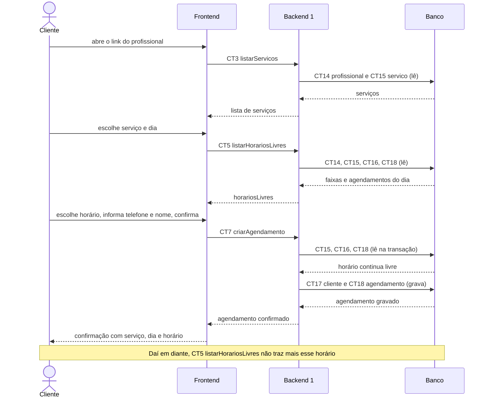

# Fluxo do E4: Agendamento de horário pelo cliente

**Feito quando (da Entrega 1):** O cliente escolhe um serviço e um horário disponível, confirma o agendamento, e o horário se torna indisponível para demais clientes.

## Passos

1. O cliente abre o link do profissional (por exemplo, /p/ana-unhas), sem login.
2. O Frontend chama listarServicos (CT3). O Backend 1 lê as tabelas profissional (CT14) e servico (CT15) e devolve os serviços.
3. O cliente escolhe um serviço e um dia. O Frontend chama listarHorariosLivres (CT5), e o Backend 1 calcula os horários livres lendo CT14, CT15, CT16 e CT18 (mesma regra do fluxo [E2](E2-configuracao-de-horarios-de-atendimento.md)).
4. O cliente escolhe um horário, informa telefone e nome e confirma. (O reconhecimento do telefone de quem já agendou antes é o fluxo [E5](E5-cadastro-simplificado-do-cliente.md).)
5. O Frontend chama o Backend 1 com a operação criarAgendamento (CT7).
6. O Backend 1, dentro de uma transação, lê de novo servico (CT15), horario_atendimento (CT16) e agendamento (CT18) e confere se o horário continua livre.
7. O Backend 1 procura o cliente pelo telefone; se ele ainda não existir, cria o registro na tabela cliente (CT17). Em seguida, grava o agendamento na tabela agendamento (CT18), com status confirmado e lembrete_status pendente.
8. O Backend 1 responde com o agendamento confirmado, e a tela mostra a confirmação ao cliente.
9. Daí em diante, quando qualquer cliente pede os horários livres daquele dia (CT5), o horário agendado não vem mais na lista.

## Diagrama

**Contratos usados:** CT3 listarServicos, CT5 listarHorariosLivres, CT7 criarAgendamento, CT14 profissional, CT15 servico, CT16 horario_atendimento, CT17 cliente, CT18 agendamento.
