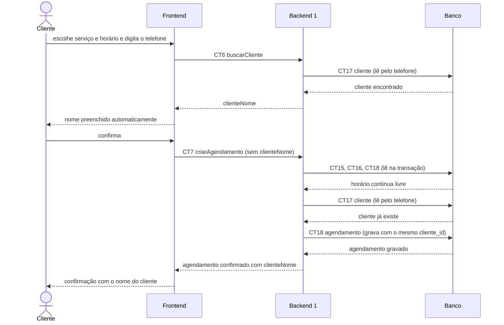

# Fluxo do E5: Cadastro simplificado do cliente

**Feito quando (da Entrega 1):** O cliente informa nome e telefone no primeiro agendamento, e nos agendamentos seguintes o sistema já reconhece esses dados automaticamente.

## Passos

1. No primeiro agendamento, o cliente informa nome e telefone, e o criarAgendamento (CT7) cria o cliente na tabela cliente (CT17), como no fluxo [E4](E4-agendamento-de-horario-pelo-cliente.md).
2. Em um agendamento seguinte, o cliente abre o link do profissional e escolhe serviço e horário (como nos passos 1 a 3 do fluxo E4).
3. O cliente digita só o telefone.
4. O Frontend chama o Backend 1 com a operação buscarCliente (CT6).
5. O Backend 1 lê a tabela cliente (CT17) pelo telefone e devolve o nome cadastrado.
6. O Frontend preenche o nome automaticamente, e o cliente só confirma.
7. O Frontend chama criarAgendamento (CT7) com o telefone, sem precisar mandar o nome.
8. O Backend 1 confere o horário (lê CT15, CT16 e CT18), encontra o cliente pelo telefone na tabela cliente (CT17), não cria outro, e grava o agendamento ligado a esse mesmo cliente (CT18).
9. O Backend 1 responde, e a tela mostra a confirmação já com o nome do cliente.

## Diagrama

**Contratos usados:** CT6 buscarCliente, CT7 criarAgendamento, CT15 servico, CT16 horario_atendimento, CT17 cliente, CT18 agendamento.
