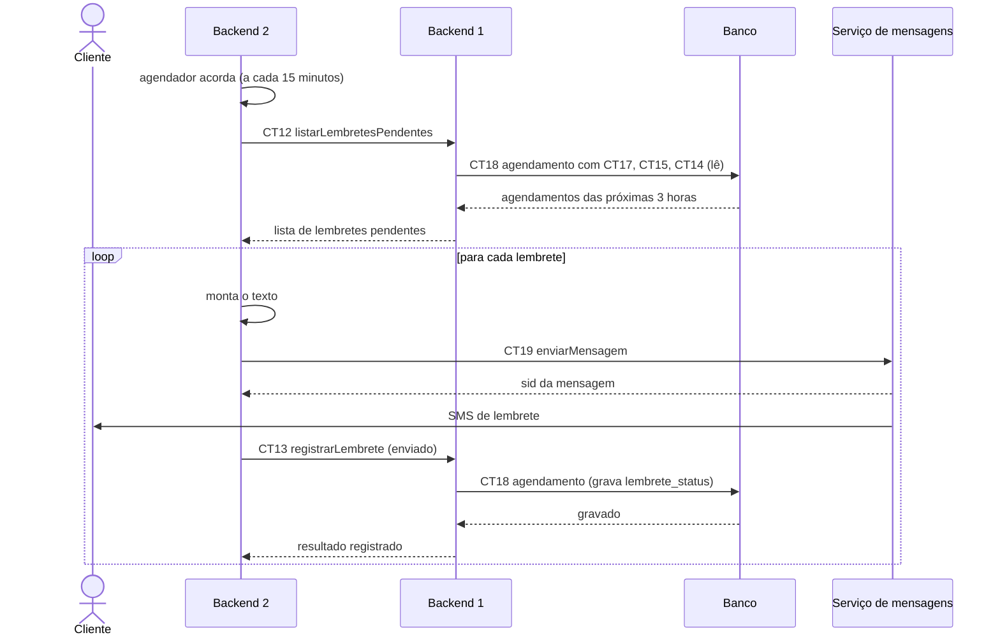

# Fluxo do E6: Lembrete automático antes do horário

**Feito quando (da Entrega 1):** O sistema envia uma mensagem automática ao cliente algumas horas antes do horário marcado, lembrando do compromisso.

Nesta especificação, "algumas horas" é 3 horas (ver a [visão geral](visao-geral.md)). Ninguém clica em nada: quem dispara o fluxo é o relógio do Backend 2. A pessoa do diagrama é o cliente, que recebe o lembrete.

## Passos

1. A cada 15 minutos, o agendador do Backend 2 acorda.
2. O Backend 2 chama o Backend 1 com a operação listarLembretesPendentes (CT12), mandando `ate` igual a agora mais 3 horas.
3. O Backend 1 lê a tabela agendamento (CT18), junto com cliente (CT17), servico (CT15) e profissional (CT14), e separa os agendamentos confirmados, com lembrete_status pendente e inicio entre agora e `ate`.
4. O Backend 1 devolve a lista de lembretes pendentes.
5. Para cada lembrete, o Backend 2 monta o texto e chama o Serviço de mensagens com enviarMensagem (CT19).
6. O Serviço de mensagens entrega o SMS no telefone do cliente.
7. O Backend 2 chama registrarLembrete (CT13) com resultado enviado.
8. O Backend 1 grava lembrete_status e lembrete_registrado_em na tabela agendamento (CT18), e esse agendamento não volta mais na lista do passo 3.

## Diagrama

**Contratos usados:** CT12 listarLembretesPendentes, CT13 registrarLembrete, CT19 enviarMensagem, CT14 profissional, CT15 servico, CT17 cliente, CT18 agendamento.
