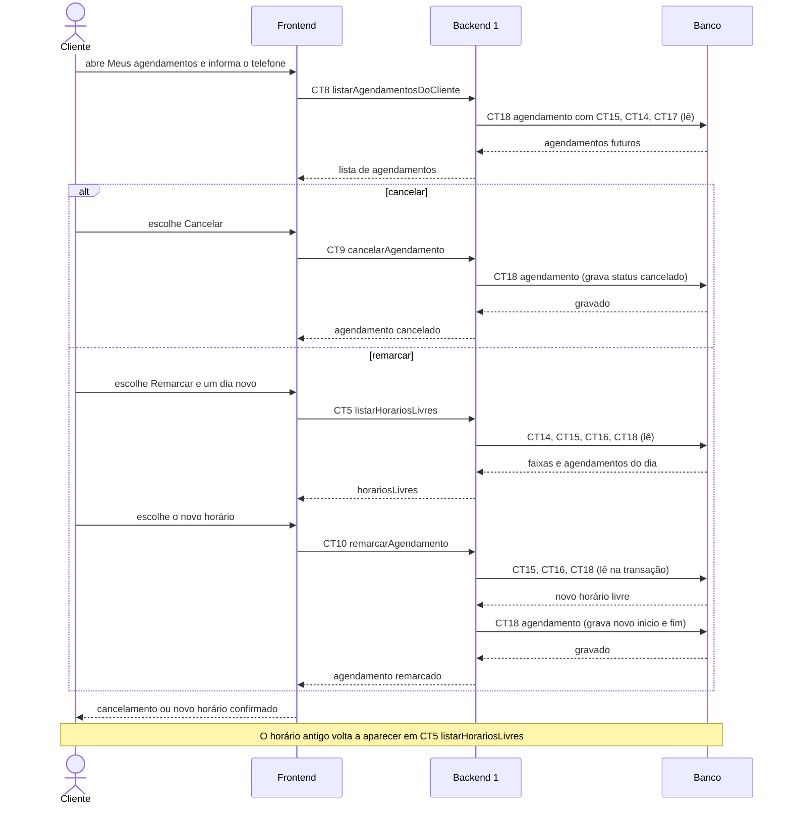

# Fluxo do E7: Cancelamento e reagendamento pelo cliente

**Feito quando (da Entrega 1):** O cliente cancela ou remarca um agendamento já feito, e o horário liberado volta a aparecer como disponível para outros clientes.

## Passos

1. O cliente abre "Meus agendamentos" pelo link do profissional e informa o telefone.
2. O Frontend chama listarAgendamentosDoCliente (CT8). O Backend 1 lê a tabela agendamento (CT18), junto com servico (CT15), profissional (CT14) e cliente (CT17), e devolve os agendamentos futuros confirmados.
3. Para cancelar: o cliente escolhe "Cancelar". O Frontend chama cancelarAgendamento (CT9), o Backend 1 confere se o telefone é o do agendamento e se ele ainda não passou, grava status cancelado na tabela agendamento (CT18) e responde.
4. Para remarcar: o cliente escolhe "Remarcar" e um dia novo. O Frontend chama listarHorariosLivres (CT5) e mostra os horários livres.
5. O cliente escolhe o novo horário. O Frontend chama remarcarAgendamento (CT10).
6. O Backend 1 confere o telefone e se o novo horário está livre (lê CT15, CT16 e CT18), grava o novo inicio e fim no mesmo agendamento, volta o lembrete_status para pendente (CT18) e responde.
7. A tela mostra o agendamento cancelado ou o novo horário.
8. Como o CT5 só considera agendamentos confirmados no horário de cada um, o horário antigo volta a aparecer como livre para os outros clientes.

## Diagrama

**Contratos usados:** CT5 listarHorariosLivres, CT8 listarAgendamentosDoCliente, CT9 cancelarAgendamento, CT10 remarcarAgendamento, CT14 profissional, CT15 servico, CT16 horario_atendimento, CT17 cliente, CT18 agendamento.
