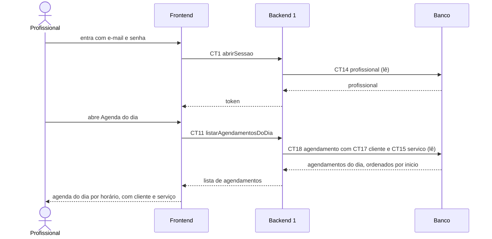

# Fluxo do E8: Painel de agenda do profissional

**Feito quando (da Entrega 1):** O profissional abre uma tela e vê todos os agendamentos do dia, com nome do cliente e serviço marcado, ordenados por horário.

## Passos

1. O profissional entra com e-mail e senha. O Frontend chama abrirSessao (CT1) e o Backend 1 lê a tabela profissional (CT14).
2. O profissional abre "Agenda do dia". O Frontend usa a data de hoje.
3. O Frontend chama o Backend 1 com a operação listarAgendamentosDoDia (CT11), mandando o token.
4. O Backend 1 lê a tabela agendamento (CT18), junto com cliente (CT17) e servico (CT15), só os agendamentos confirmados daquele profissional naquela data, ordenados por inicio.
5. O Backend 1 responde com a lista.
6. O painel mostra cada agendamento com horário, nome e telefone do cliente e serviço, em ordem de horário.
7. Se o profissional troca a data no painel, os passos 3 a 6 se repetem com a nova data.

## Diagrama

**Contratos usados:** CT1 abrirSessao, CT11 listarAgendamentosDoDia, CT14 profissional, CT15 servico, CT17 cliente, CT18 agendamento.
