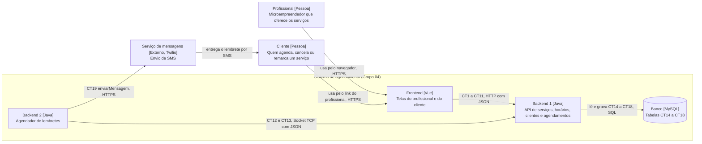

# Visão geral do sistema

**Projeto Integrador IV · Turma 0101 · Grupo 04 · Entrega 2: Especificação de Requisitos**  
PUC-Campinas · Sistemas de Informação · 2026-2

**Integrantes:** Gianluca Prestello Crugel (@G14NZS, RA 25008682), Pedro Henrique Nunes Marchetti (@PedroMarchetti-git, RA 25004236), Rafael Ferreira Lucietto (@Rafa3lFerreira, RA 25004572).

## Mudanças e esclarecimentos de escopo desde a Entrega 1

| Mudança | Motivo |
|---|---|
| O E3 (Página pública de agendamento) não tem fluxo nesta entrega. | Ele foi cortado na própria Entrega 1, na conta de viabilidade (150 horas disponíveis contra 156 pedidas). Para o E4 funcionar, o cliente ainda precisa ver os serviços e os horários livres pelo link do profissional, então essa listagem mínima aparece dentro do fluxo do E4 (CT3 e CT5), sem a página pública completa. |
| O profissional entra no sistema com e-mail e senha (CT1 abrirSessao), dentro dos entregáveis E1, E2 e E8. | Esses três entregáveis só funcionam se o sistema souber qual profissional está usando a tela. A conta do profissional é criada direto no banco, por carga inicial; uma tela de cadastro de profissional continua fora de escopo. |
| No E6, "algumas horas antes" passa a ser 3 horas antes. | O Backend 2 precisa de um valor fixo para buscar os lembretes. O canal escolhido é SMS. |

## Módulos

| Módulo | O que faz | Tecnologia | Repositório | Responsável |
|---|---|---|---|---|
| Frontend | Telas do profissional (serviços, horários, agenda do dia) e telas do cliente, abertas pelo link do profissional (agendar, cancelar, remarcar) | Vue | pi4-2026-2-0101-grupo04-frontend | Gianluca Prestello Crugel |
| Backend 1 | Recebe as ações das telas e guarda profissionais, serviços, horários, clientes e agendamentos; calcula os horários livres | Java | pi4-2026-2-0101-grupo04-backend-1 | Pedro Henrique Nunes Marchetti |
| Backend 2 | A cada 15 minutos busca os agendamentos das próximas 3 horas e manda o lembrete ao cliente | Java | pi4-2026-2-0101-grupo04-backend-2 | Rafael Ferreira Lucietto |
| Banco | Guarda profissionais, serviços, horários de atendimento, clientes e agendamentos | MySQL | junto do Backend 1 | Pedro Henrique Nunes Marchetti |
| Serviço de mensagens (externo) | Entrega o SMS de lembrete no telefone do cliente | Twilio (API de mensagens) | não se aplica | Rafael Ferreira Lucietto |

## Diagrama de contêineres (C4, nível 2)

## Convenção de nomes

Nas mensagens HTTP entre o Frontend e o Backend 1 usamos camelCase (`servicoId`, `clienteTelefone`, `atualizadoEm`). Na comunicação entre Backend 1 e Backend 2, realizada por socket TCP, também utilizamos mensagens JSON com campos em camelCase. No banco usamos snake_case, com tabelas no singular (`servico_id`, `criado_em`, `horario_atendimento`).

Nome de operação é verbo no infinitivo mais o objeto (`cadastrarServico`, `listarHorariosLivres`). Código de erro é em maiúsculas com sublinhado (`HORARIO_INDISPONIVEL`). Nos contratos com serviço externo, os campos mantêm o nome da documentação do serviço (`To`, `Body`, `sid`).

## Combinados que valem para todos os contratos

- Data e hora vão sem fuso, sempre no horário de Brasília (`2026-10-20T14:00:00`). Hora do dia, sem data, vai como texto no formato HH:MM (`09:00`).
- Telefone vai como texto no formato +55, DDD e número, só dígitos (`+5519988887777`).
- Todo erro HTTP volta com o código de status e o corpo `{ "erro": CODIGO, "mensagem": texto para a tela }`, em que `erro` e `mensagem` são do tipo texto.
- A comunicação entre Frontend e Backend 1 ocorre por HTTP/JSON.
- A comunicação entre Backend 1 e Backend 2 ocorre por socket TCP com mensagens JSON. Nas mensagens por socket, o pedido leva `operacao`, `dados` e `chaveInterna` quando aplicável. A resposta de sucesso leva `ok: true` e `dados`; em caso de erro, `ok: false`, `erro` e `mensagem`.
- O Backend 1 acessa o banco por SQL.
- O Backend 2 se comunica com o serviço externo de mensagens por HTTPS.

## Índice de fluxos

- [E1 — Cadastro de serviço](E1-cadastro-de-servico.md)
- [E2 — Configuração de horários de atendimento](E2-configuracao-de-horarios-de-atendimento.md)
- [E4 — Agendamento de horário pelo cliente](E4-agendamento-de-horario-pelo-cliente.md)
- [E5 — Cadastro simplificado do cliente](E5-cadastro-simplificado-do-cliente.md)
- [E6 — Lembrete automático antes do horário](E6-lembrete-automatico-antes-do-horario.md)
- [E7 — Cancelamento e reagendamento pelo cliente](E7-cancelamento-e-reagendamento-pelo-cliente.md)
- [E8 — Painel de agenda do profissional](E8-painel-de-agenda-do-profissional.md)

> O E3 foi retirado do escopo e, por isso, não possui arquivo de fluxo nesta entrega.

## Localização dos contratos

- CT1 a CT18: `pi4-2026-2-0101-grupo04-backend-1/docs/contratos/`
- CT19: `pi4-2026-2-0101-grupo04-backend-2/docs/contratos/`
